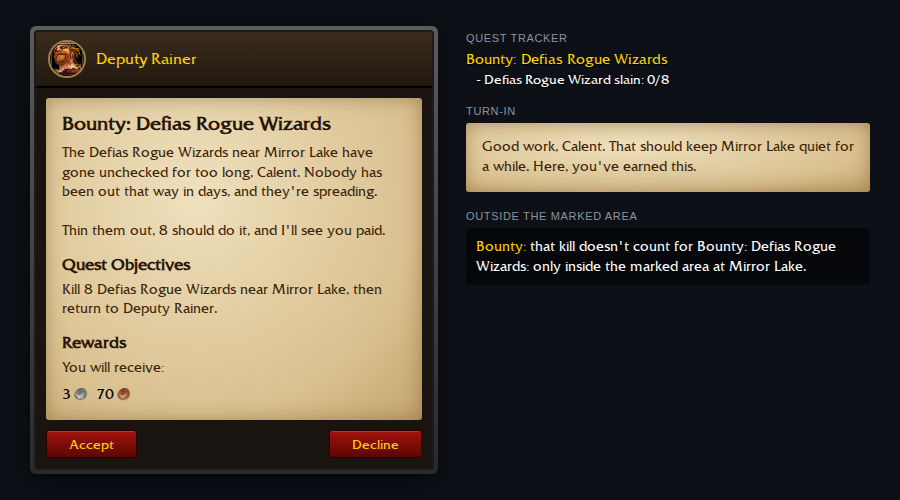
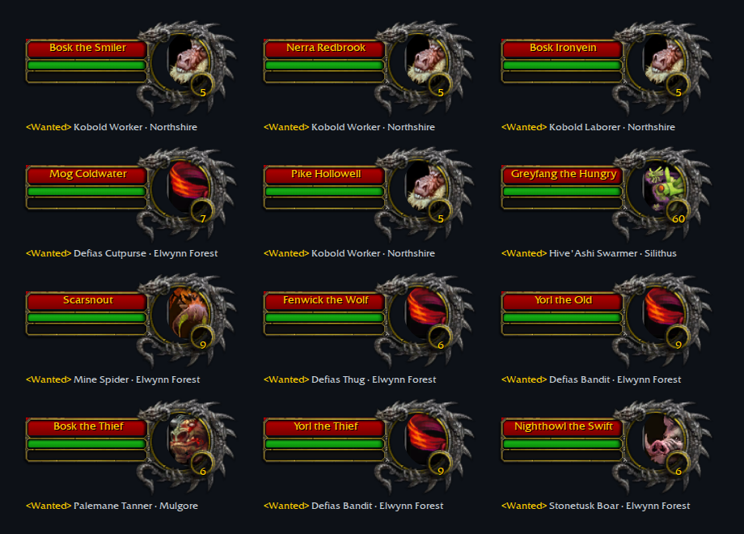
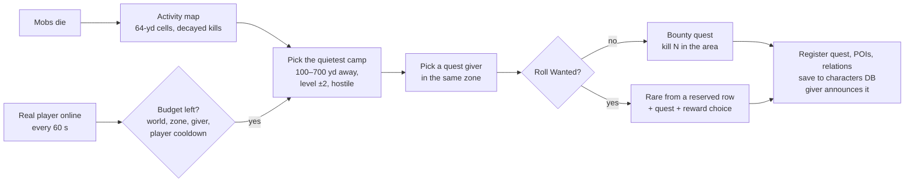

# mod-procedurality

**Generated quests and rewards for AzerothCore 3.3.5a**

A director watches where players are and what gets killed, and posts new quests around them: bounties on quiet
camps, and named Wanted rares with gear to choose from.

 A live bounty, drawn from its <code>procedurality_quest_template</code> row in the client's quest font.

## What it posts

| | |
|---|---|
| **Bounty** | "Kill 8 Defias Rogue Wizards near Mirror Lake." A quiet camp near the player, given out by a real quest NPC in the same zone. Kills only count inside the marked area, which the world map shows; a kill outside it tells the player where to go. |
| **Wanted** | A named silver-dragon rare built from a camp creature (3× health, its own name and `<Wanted>` title), and a quest to kill it. The reward is a choice of gear, one per armor type plus jewelry and a weapon. With mod-forge, each player who turns it in gets a freshly rolled affixed copy of their pick, shown as a preview in the dialog. |

Quests are offered for two hours, then holders get two more to turn them in. After that they are retired from
every quest log. Quest IDs (910000+) and rare entries (190100–191099) are never reused, so no client ever shows a
stale cached quest or name. Both survive restarts.

 Every Wanted rare posted on our realm so far, from <code>procedurality_bounty</code>.

## How it works

- **Real quests.** Each incident is a real `Quest` registered with the core at runtime, with world map POIs and the
  giver's "!" and "?". The objective is the real creature entry, so the tracker shows its real name.
- **Text.** Titles, dialog and the giver's line come from weighted templates in `procedurality_text`, picked by
  creature type and filled with the target, count, area, zone and giver.
- **Threading.** Everything runs on the world thread after the map update. Map threads only write each continent's
  activity grid and read the bounty registry.

## Install

1. Clone into `azerothcore-wotlk/modules/mod-procedurality`, next to
   [mod-forge](https://github.com/italicninja/mod-forge), which it needs for affixed rewards (`ForgeMgr.h`).
2. Apply the core patch `0004-generated-quest-hooks`. It adds runtime quest registration to ObjectMgr
   (`ReserveQuestTemplates`, `AddGeneratedQuest`, `HasGeneratedQuests`, `SetQuestPOIs`, `RemoveQuestPOIs`) and three
   hooks: `PlayerScript::OnPlayerBeforeQuestRewardItem`, `PlayerScript::OnPlayerBeforeSendQuest` and
   `WorldScript::OnAfterQuestDataReload`.
3. Apply the SQL by hand: `sql/characters/` into `acore_characters`, then `sql/world/` into `acore_world` (see
   `sql/README.md`). It stays out of `data/sql/` on purpose, so the core's DB updater doesn't import it.
4. Re-run CMake, build, and copy `conf/mod_procedurality.conf.dist` to `etc/modules/mod_procedurality.conf`.

Without its tables the module logs an error at startup and posts nothing.

## Configuration

`etc/modules/mod_procedurality.conf`. Each key is documented in the `.dist` file.

| Key | Default | What |
|---|---|---|
| `Procedurality.Enable` | `0` | Run the director (posted quests always load, expire and can be turned in) |
| `Procedurality.Interval` | `60` | Seconds between director runs |
| `Procedurality.Debug` | `0` | Director messages for GMs: `1` events, `2` also every decision |
| `Procedurality.Activity.HalfLifeMinutes` | `30` | How fast the kill counts that find quiet camps decay |
| `Procedurality.Bounty.MaxActive` / `MaxPerZone` / `MaxPerGiver` | `30` / `2` / `3` | Budgets |
| `Procedurality.Bounty.PlayerCooldownMinutes` | `20` | At most one new incident per player per this |
| `Procedurality.Bounty.SearchYards` / `MinYards` / `CampYards` / `MinCampSize` | `700` / `100` / `80` / `5` | Camp search |
| `Procedurality.Bounty.GiverYards` | `900` | How far the giver may be from the camp |
| `Procedurality.Bounty.OfferMinutes` / `GraceMinutes` | `120` / `120` | Lifetime |
| `Procedurality.Bounty.XPDifficulty` / `MoneyRate` | `5` / `1.0` | Rewards |
| `Procedurality.Wanted.Chance` / `MaxActive` / `MaxPerZone` | `35` / `5` / `1` | Wanted rolls and budgets |
| `Procedurality.Wanted.HealthMultiplier` / `DamageMultiplier` | `3.0` / `1.3` | The rare |
| `Procedurality.Wanted.RespawnMinutes` | `10` | The rare returns until the quest retires |
| `Procedurality.Wanted.BlueChance` / `XPDifficulty` | `25` / `6` | Rewards |
| `Procedurality.Rewards.Affixes` | `1` | Roll Wanted rewards with mod-forge affixes (needs `Forge.Enable`); `0`: plain greens and blues |

Log channel: `module.procedurality`.

## GM commands

`.procedurality`, or `.proc`.

| Command | What |
|---|---|
| `.proc status` | Director state and every live incident |
| `.proc bounty` / `.proc wanted` | Post one for yourself now, ignoring budgets and cooldowns |
| `.proc retire <questId>` | Take an incident out of every quest log and off its giver |
| `.proc tick` | Run the director now |

## For other modules

`src/ProceduralityMgr.h` is the API. `ProceduralityMgr::IsGeneratedQuest(id)` and `IsRareEntry(entry)` tell
generated quests and rares apart, `sProceduralityMgr->GetBounty(questId)` returns an incident (kind, area, target,
giver, rare), and `Post()` posts one for a player. The core hooks from `0004-generated-quest-hooks` are generic, so
another module can register its own runtime quests the same way.

## Status

Extracted on 2026-10-20 from the wowproject core patch `0004-procgen`, where it ran live from 2026-10-14; it has
run live as a module since 2026-10-21. This repo's version targets mod-forge's `ForgeMgr` (the module was built
against the core's `ItemAffixMgr` before the forge split) and hasn't been built yet. The design doc
(`docs/procedurality.md`) lives in the wowproject repo for now. Next: safer camp choice (water, linked packs),
then camps with scout-and-clear quests, and quest chains.

## License

GPL-2.0, like AzerothCore. See `LICENSE`.
